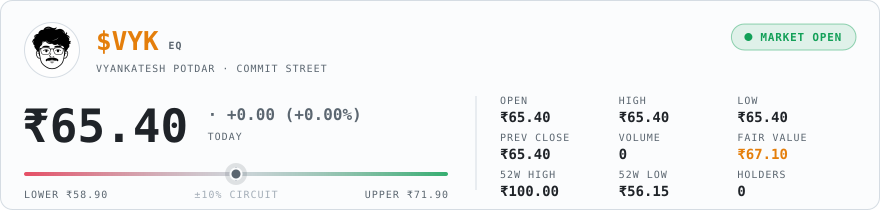
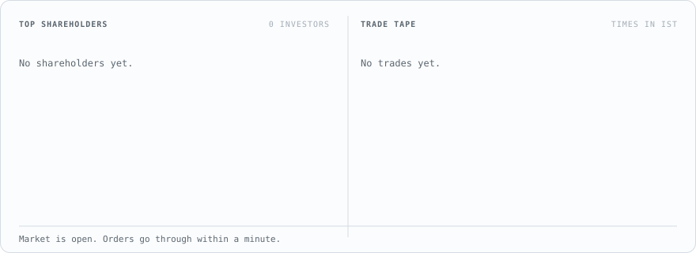
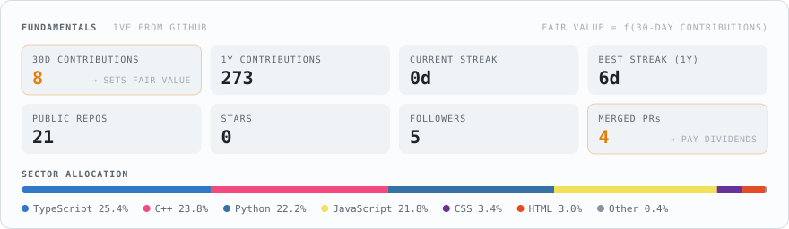

<p align="center"><picture><source media="(prefers-color-scheme: dark)" srcset="assets/dark/city.50c35c9b32.svg"></picture></p>

<p align="center"><sub>The sky follows the time in Bengaluru. Pick a time of day to see the city then.</sub><br>
<a href="https://github.com/vyankateshpotdar/vyankateshpotdar/blob/HEAD/views/dawn.md"><picture><source media="(prefers-color-scheme: dark)" srcset="assets/dark/light-dawn.c0781e5e99.svg"></picture></a> <a href="https://github.com/vyankateshpotdar/vyankateshpotdar/blob/HEAD/views/day.md"><picture><source media="(prefers-color-scheme: dark)" srcset="assets/dark/light-day.76f0d9d739.svg"></picture></a> <a href="https://github.com/vyankateshpotdar/vyankateshpotdar/blob/HEAD/views/dusk.md"><picture><source media="(prefers-color-scheme: dark)" srcset="assets/dark/light-dusk.b32a862c01.svg"></picture></a> <a href="https://github.com/vyankateshpotdar/vyankateshpotdar/blob/HEAD/views/night.md"><picture><source media="(prefers-color-scheme: dark)" srcset="assets/dark/light-night.85cbf61604.svg"></picture></a></p>


<details>
<summary>How Commit City works</summary>
<br>
<p>Everything in this city comes from my GitHub activity, and it grows as I commit. The first building cost 25 contributions and each one after costs 5 more, so it filled in quickly at first and grows slower now. It never shrinks.</p>
<p>Each building is one of my public repos. Repos I pushed to in the last four months are glass towers, the ones from the last two years are apartment blocks, and older ones are tile-roof houses. The more I committed to a repo this year, the taller it is.</p>
<p>The metro is my contribution graph: one coach per week and one window per day, lit on days I committed. The street under each coach is as busy as that week was. BMTC buses are pull requests merged this year, with the repo and PR number on the side, and the planes carry my DEV posts.</p>
<p>Commit Soudha, the town hall, starts going up at 800 contributions and opens at 1,500. There's a new tree for every 20.</p>
<p>The sky follows the time in Bengaluru. A GitHub Action redraws the city a few times a day, so there's no server and nothing to update by hand.</p>
</details>

<p align="center"><sub>City generator: <a href="https://github.com/vineetjk/vineetjk">Commit City</a>.</sub></p>

<p align="center"><picture><source media="(prefers-color-scheme: dark)" srcset="assets/dark/sign.7bbc92792e.svg"></picture></p>

<p align="center"><picture><source media="(prefers-color-scheme: dark)" srcset="assets/dark/ticker.246b54cbae.svg"></picture></p>

<p align="center"><picture><source media="(prefers-color-scheme: dark)" srcset="assets/dark/quote.0e32a1638d.svg"></picture></p>

<p align="center"><picture><source media="(prefers-color-scheme: dark)" srcset="assets/dark/chart.9e1ef1949f.svg"></picture></p>

<p align="center"><a href="https://github.com/vyankateshpotdar/vyankateshpotdar/issues/new?title=BUY%205%20%24VYK&amp;body=Hit%20**Create**%20and%20the%20Commit%20Street%20bot%20fills%20this%20order%20in%20about%20a%20minute.%0A%0A-%20Change%20the%20number%20in%20the%20title%20to%20trade%20anywhere%20from%201%20to%2025%20shares.%0A-%20Outside%20market%20hours%20(09%3A15%E2%80%9315%3A30%20IST%2C%20Mon%E2%80%93Fri)%20the%20order%20waits%20for%20the%20next%20opening%20bell.%20Close%20this%20issue%20to%20cancel%20it.%0A-%20You%20start%20with%20%E2%82%B910%2C000%20of%20play%20money.%20Nothing%20here%20is%20real."><picture><source media="(prefers-color-scheme: dark)" srcset="assets/dark/buy-5.4cfabf785d.svg"></picture></a>
<a href="https://github.com/vyankateshpotdar/vyankateshpotdar/issues/new?title=BUY%2025%20%24VYK&amp;body=Hit%20**Create**%20and%20the%20Commit%20Street%20bot%20fills%20this%20order%20in%20about%20a%20minute.%0A%0A-%20Change%20the%20number%20in%20the%20title%20to%20trade%20anywhere%20from%201%20to%2025%20shares.%0A-%20Outside%20market%20hours%20(09%3A15%E2%80%9315%3A30%20IST%2C%20Mon%E2%80%93Fri)%20the%20order%20waits%20for%20the%20next%20opening%20bell.%20Close%20this%20issue%20to%20cancel%20it.%0A-%20You%20start%20with%20%E2%82%B910%2C000%20of%20play%20money.%20Nothing%20here%20is%20real."><picture><source media="(prefers-color-scheme: dark)" srcset="assets/dark/buy-25.d782130d70.svg"></picture></a>
<a href="https://github.com/vyankateshpotdar/vyankateshpotdar/issues/new?title=SELL%205%20%24VYK&amp;body=Hit%20**Create**%20and%20the%20Commit%20Street%20bot%20fills%20this%20order%20in%20about%20a%20minute.%0A%0A-%20Change%20the%20number%20in%20the%20title%20to%20trade%20anywhere%20from%201%20to%2025%20shares.%0A-%20Outside%20market%20hours%20(09%3A15%E2%80%9315%3A30%20IST%2C%20Mon%E2%80%93Fri)%20the%20order%20waits%20for%20the%20next%20opening%20bell.%20Close%20this%20issue%20to%20cancel%20it.%0A-%20You%20start%20with%20%E2%82%B910%2C000%20of%20play%20money.%20Nothing%20here%20is%20real."><picture><source media="(prefers-color-scheme: dark)" srcset="assets/dark/sell-5.03e4656b0f.svg"></picture></a>
<a href="https://github.com/vyankateshpotdar/vyankateshpotdar/issues/new?title=SELL%2025%20%24VYK&amp;body=Hit%20**Create**%20and%20the%20Commit%20Street%20bot%20fills%20this%20order%20in%20about%20a%20minute.%0A%0A-%20Change%20the%20number%20in%20the%20title%20to%20trade%20anywhere%20from%201%20to%2025%20shares.%0A-%20Outside%20market%20hours%20(09%3A15%E2%80%9315%3A30%20IST%2C%20Mon%E2%80%93Fri)%20the%20order%20waits%20for%20the%20next%20opening%20bell.%20Close%20this%20issue%20to%20cancel%20it.%0A-%20You%20start%20with%20%E2%82%B910%2C000%20of%20play%20money.%20Nothing%20here%20is%20real."><picture><source media="(prefers-color-scheme: dark)" srcset="assets/dark/sell-25.ee465eefe1.svg"></picture></a></p>

<p align="center"><sub>Buttons open a pre-filled issue. Hit <b>Create</b> to place your order.</sub></p>

<p align="center"><picture><source media="(prefers-color-scheme: dark)" srcset="assets/dark/book.c6974bb921.svg"></picture></p>

<p align="center"><picture><source media="(prefers-color-scheme: dark)" srcset="assets/dark/fundamentals.4164f911d1.svg"></picture></p>

<details>
<summary>How does this work?</summary>
<br>
<p>The price follows my GitHub activity. A normal month for me is around 30 contributions, and that's worth ₹100 a share. If I stop coding for a month, that drops to half. When the market closes each day, the price moves 20% of the way toward whatever my last 30 days say it's worth.</p>
<p>During the day you move it. Every share bought pushes it up 0.15%, every share sold pushes it down, and you pay the price after your own push. So buying and selling straight away loses you a little.</p>
<p>It can't go more than 10% above or below the previous close. Once it hits that limit, buying (or selling, if it's falling) stops until the next day.</p>
<p>The market is open 09:15 to 15:30 IST, Monday to Friday. Orders placed outside those hours wait for the next morning. Close your issue if you change your mind.</p>
<p>You start with ₹10,000 of play money. Up to 25 shares per order. Whenever one of my pull requests gets merged, everyone holding shares gets ₹2 per share. I can't buy my own stock.</p>
<p>There's no server behind this. A GitHub Action runs at the open, at the close and whenever someone places an order, then redraws these images. Every trade is in <a href="data/market.json">data/market.json</a>.</p>
</details>

<p align="center"><picture><source media="(prefers-color-scheme: dark)" srcset="assets/dark/footer.14cb2fd293.svg"></picture></p>


<p align="center"></p>

<div align="center">


<sub>my GitHub profile is a pond now. the koi grows with my commits.</sub>

<br>

[](https://github.com/vyankateshpotdar)
[](https://linkedin.com/)
[](mailto:vyankateshpotdar411@gmail.com)


</div>

<details>
<summary><b>How the koi works</b></summary>

<br>

Everything about the koi comes from my public GitHub activity. The languages I write color it, my contributions grow it, my streaks mark it, and the day that just ended decides how it swims.

A GitHub Action redraws it every night just after midnight UTC and commits a new `koi/koi.gif`. There's no server and nothing to update by hand.

Made with [git-koi](https://github.com/yalongwastaken/git-koi).

</details>

<br>

## 🌊 about me

```python
class Vyankatesh:
    def __init__(self):
        self.role = "CS undergrad, professional task-automator"
        self.grad_year = 2029
        self.location = "Pune, India"
        self.stack = ["Python", "TypeScript", "FastAPI", "PostgreSQL"]
        self.red_flags = ["forgets to check Amazon manually", "lets bots do it"]
        self.actually_doing = "building a bot army so boring tasks fear me"

    def manual_labor(self, task):
        if task.is_repetitive or task.is_boring:
            return "nah, writing a script for that 🤖"
        return "fine i'll do it myself this once"

me = Vyankatesh()
print(me.manual_labor(task="checking 5 sites for a price drop"))
# >>> nah, writing a script for that 🤖
```

## 🪷 what's in the pond

<table>
<tr>
<td width="50%" valign="top">

**📉 Price Tracker & Alert Bot**
<br><sub>May 2026 – now</sub>

Watches Amazon, Flipkart, Ajio, Myntra and Meesho so I don't have to, and pings me when a price drop is actually worth it.

`TypeScript` `Node.js` `Prisma` `PostgreSQL` `node-cron`

</td>
<td width="50%" valign="top">

**🔔 Discord Bump Reminder Bot**
<br><sub>Aug 2025 – now</sub>

Remembers the 2-hour server bump so humans don't have to. `!nextbump` shows how long you've got.

`Python` `discord.py` `AsyncIO`

</td>
</tr>
<tr>
<td width="50%" valign="top">

**₿ Real-time BTC Price Alert Bot**
<br><sub>Aug 2025 – Dec 2025</sub>

Pings Telegram the moment BTC moves ±$500, so I can stop refreshing my crypto app. Anxiety, automated.

`Python` `FastAPI` `Uvicorn` `Binance API`

</td>
<td width="50%" valign="top">

**♟️ Square Focus Chess Club**
<br><sub>Founder & Community Manager · 2020 – now</sub>

Not a bot, an actual community: chess people across Discord, Instagram and YouTube.

`Community Building` `Discord Mgmt` `Social Strategy`

</td>
</tr>
</table>

## 🛠️ tools i swim with

<div align="center">


</div>

## 🎓 education & certifications

**B.Tech, Computer Science & Engineering**: MIT-ADT University, Pune · 2025 – 2029 *(first year)*

<details>
<summary><b>Certifications (5)</b></summary>

<br>

- 🏆 Advanced C++ Training: Spoken Tutorial, IIT Bombay *(Apr 2026)*
- 🐍 CS50P, Introduction to Programming with Python: Harvard University *(Aug 2025)*
- 💻 C Training: IIT Bombay *(Nov 2025)*
- 📊 Deloitte Australia, Data Analytics Job Simulation: Forage *(Dec 2025)*
- 🤖 AI Aware Badge: Digital India Corporation *(Jul 2025)*

</details>

## 🎯 right now

```
┌──────────────────────────────────────────────────┐
│  🔭  building bots so future-me does less work    │
│  🌱  leveling up on scraping & API witchcraft     │
│  ♟️  running a chess club, unofficial hobby: chaos │
│  📣  social media for ACM-W (yes i make memes)    │
│  ⚡  dms open for internships & cool collabs       │
└──────────────────────────────────────────────────┘
```

<div align="center">

**"life's too short to do boring tasks twice. write the script."** 💀🤖


</div>
